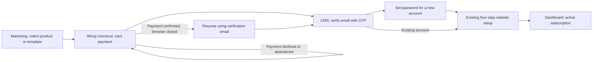
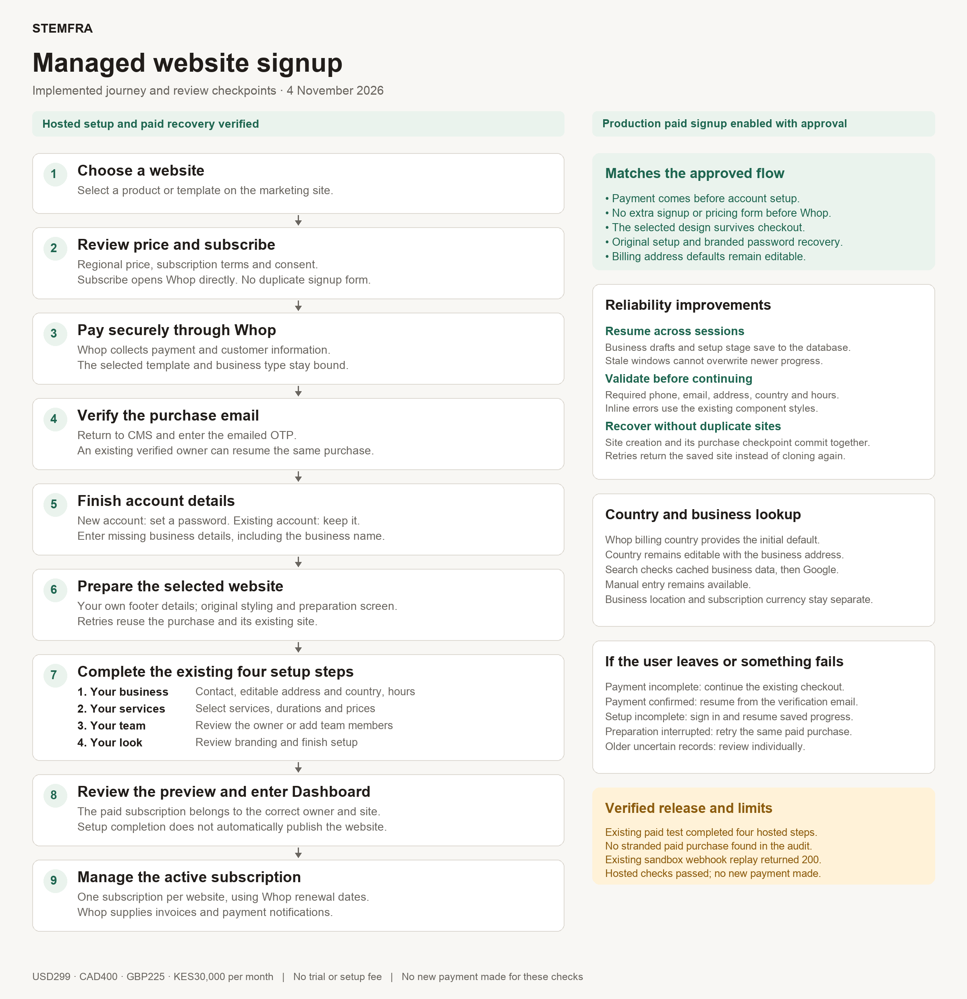

# Managed website: purchase to setup

Approved by Peter on 3 November 2026. The approved journey is deployed; current hosted acceptance and limits follow.

## Latest popup styling, 4 November 2026

Removed renewal/tax and service-description paragraphs at Peter’s request. Only the plan name/price, linked agreement and Continue remain, with a larger40px gap before agreement. No Cancel button; close icon and Escape remain. Existing pricing card/Offer box classes are reused exactly for colors, border shape and typography. Local browser verified; not deployed.

## Local review-popup follow-up, 4 November 2026

Latest requested UI is implemented locally: pricing card Subscribe → in-page subscription/price review → Continue → Whop. No checkbox or standalone agreement page. The review states "By clicking Continue, you agree to..." with Terms of Service, Privacy Policy and Fees & Payments Policy links. Clicking Continue submits explicit consent with the existing immutable quote/template/business context; merely opening or canceling does not start checkout. Server quote/consent requirements remain intact. Existing design tokens and buttons retained.

Local /websites and /pricing browser checks cover regional price agreement, no checkbox, closing/focus restoration and narrow-screen readability. Marketing build/prerender99routes passes. New Continue/purchase was not exercised against Whop; no new payment or consent was submitted. This popup update is not pushed or deployed; hosted acceptance below describes the prior released UI. [Pricing screenshot](evidence/website-pricing-clean-local.png), [review screenshot](evidence/website-subscription-review-local.png), [narrow screen](evidence/website-subscription-review-mobile.png).

## Current acceptance, 4 November 2026

Production paid website signup is deployed and enabled after Peter's explicit approval. API deployment [41734352333](https://github.com/stemfra/stemfra-server/actions/runs/41734352333) succeeded at `e0b7b08`; hosted `/api/website-purchase/config` returns `{"enabled":true}`. CMS production is `245672e`, marketing production `f16db72`; both Cloudflare deployments succeeded. Existing sandbox purchase was reused throughout. No new checkout/payment, domain purchase or test-site publishing.

| Hosted check | Confirmed result |
| --- | --- |
| Existing four setup steps | Business required-phone validation blocked empty phone, then original fictional phone restored and saved. Services retained. Plain `/setup` resumed saved Services and later Team. Team saved to Your look; Finish reached the original personalized preview and Dashboard. |
| Server persistence | Final private stage `preview`, business draft null, revision40. Canonical fictional Canadian address/phone retained. Separate physical-device acceptance was not performed. |
| Subscription | Billing shows Active, Card, KES30,000/month, December3,2026 renewal. Database retains one subscription and exact provider period end `2026-12-03T15:02:16.706Z`. |
| Paid-link recovery | Reopened original capability link while signed in as its owner. Returned to the same site's preview without another OTP/payment/site. One paid intent and one active subscription remain. Original OTP timestamp `2026-11-03T19:36:45.248Z` and completion `2026-11-03T19:40:36.157Z` unchanged. Capability itself is excluded from documentation. |
| Legacy signup routing | Hosted `/signup?country=CA&starter=rourke-sloane` redirects to the website offer with both parameters and `#plan`, without another signup/pricing form. Consent remains unchecked; no checkout created. |
| Regional UI | Hero, offer and closing price agree after market selection. Canada shows CA$400/month; selection updates and preserves URL context. Four hosted offer currencies/plans verified earlier in this release. |
| Password reset style | Login, reset request, sent confirmation and new-password screens now share AuthFrame, original Stemfra header/photo layout, rounded fields and violet button. Request and new-password screens visually verified on production. Sent confirmation visually verified in isolated preview with email delivery stubbed; no repeat reset email or password change. Peter completed the real reset before the style update. |
| Business-owned footer | Source identity fields are cleared during new paid provisioning without changing design tokens. Finish repairs only source-matching values and preserves owner edits, including when page copy is already complete. Paid test database/browser verified its own Toronto description, current copyright and no demo social links. No social profile is guessed; the existing CMS and business lookup remain the ways to supply real accounts. [Screenshot](evidence/website-footer-own-details.png). |
| Sandbox delivery | Existing website webhook URL restored, existing delivery replay returned200 in1.19s, badge Active. Durable inbox remains done; invoice count unchanged on replay. See runbook. Temporary hostname still depends on its local tunnel. |
| Stranded older purchases | Reviewed all3 sandbox purchase rows and5 website provider payments. No provisioning-without-site record or stranded paid purchase found. Two unpaid pending rows left unchanged. Older uncertain records still require individual review if encountered. |

### Improvements made during acceptance

The approved payment-first journey remains intact. Old signup styling is shared instead of independently redesigned; fresh-OTP completion now resumes an already-completed purchase immediately. Business country is editable, required fields validate before canonical saves, setup drafts/stage are private database records, stale writes are rejected, and site creation/checkpoint commit atomically. Regional marketing prices now stay consistent, and password recovery shares sign-in styling.

### Evidence and limits

[Hosted required-phone validation](evidence/website-phone-validation-hosted.png), [active subscription](evidence/website-subscription-hosted.png), [paid recovery preview](evidence/website-recovery-hosted.png), [hosted reset request](evidence/website-reset-request-hosted.png), [hosted new-password form](evidence/website-new-password-hosted.png), [isolated sent confirmation](evidence/website-reset-confirmation-preview.png).

The test site remains unpublished. Follow-up footer repair removed the inherited Manhattan description, source social links and stale copyright from this paid test. Its own Toronto description/contact details render in the same footer design. This is not certification of every page or business claim. Actual new-customer production payment, a new-account password and fresh-OTP provider round trip were not repeated. No production payment event was generated; existing production plan.updated deliveries returned200, which does not prove production payment reconciliation. Prior lifecycle/payment tests remain dated evidence. Twenty-five focused tests, seven platform typechecks and CMS/marketing builds passed; broader billing71/72 has one AI transaction fixture failure belonging to the parallel AI work.

[Refreshed journey PNG](images/managed-website-signup-2026-11-04.png) · [editable SVG](images/managed-website-signup-2026-11-04.svg) · [temporary sandbox webhook runbook](../WHOP_SANDBOX_WEBHOOK_RUNBOOK.md).

### Footer follow-up, 4 November 2026

Root cause: starter theme settings carried social handles and SEO defaults verbatim; Finish covered page sections but not theme-level footer identity. Added deterministic customer-identity preparation inside the atomic paid payload, legacy customer personalization and source-aware Finish repair. The original clone/duplicate-shop and copy-parts design behavior is preserved. Metadata is re-read before saving copy-job status so that old footer data cannot be written back. Existing source demo is never repaired. Seven identity tests plus twelve purchase/clone/transaction tests pass (20 total after the source guard test). No new payment, account, site or bulk tenant repair. Backend follow-up commit `4b06592` deployed successfully in [run41740169914](https://github.com/stemfra/stemfra-server/actions/runs/41740169914). Health200 and signup enabled=true. Hosted Finish rerun returned to the original preview and retained the corrected footer. Existing purchase, OTP/completion timestamps and active subscription remain unchanged.

## Historical local and release-preparation evidence

The dated sections below describe their state at the time. Their earlier pending, disabled and not-released statements are superseded by the current acceptance above.

## Approved journey

Marketing selects the template/business type, regional subscription price and terms. Subscribe opens Whop checkout directly. Do not insert another signup/pricing form before payment. Durable purchase metadata binds the selected source, business type and offer to the verified provider payment.

Whop collects payment and customer information. CMS verifies the purchase email. A new account sets a password; an existing account retains its password. Ask only for missing business information, then use the existing Your business, Your services, Your team and Your look screens. Use checkout defaults without preventing edits. Each site has its own subscription and provider renewal date. Whop supplies payment documents and payment emails; duplicate Stemfra invoice emails and renewal reminders remain off.

## Local acceptance: existing paid purchase, 3 November 2026

| Check | Result and evidence |
| --- | --- |
| Existing payment reused | PASS. Purchase `e4c09f5b-58b1-4be4-a52c-bbfb68fb6b71`, payment `pay_it8sp6Ep84amhv`. No new checkout or charge. Earlier user payment/OTP evidence is reused, not repeated. |
| Owner and selected source | PASS. Site `ca4a2e63-12b1-43ab-97c2-213bb386c9e5` belongs to the purchase auth user. Selected source `00000000-0000-4000-a000-000000000003` and barbershops match fresh Whop read-back. Site and source share template `cf016adb-86f3-4cf7-aa8c-e32d3520b8ed`. |
| Step 1: Your business | PASS. Whop Canadian test address prefilled; street edited and saved, reload preserved it. Business Country is searchable/editable and persists as ISO in address_parts. Fictional test phone +1 416 555 0123 added; no call/SMS sent. Readiness reached 10/10. |
| Step 2: Your services | PASS. Existing seven test services, prices and times reviewed, Next reached Team. Service currency CAD follows Canadian checkout billing country; it is separate from KES subscription pricing. No repricing performed. |
| Step 3: Your team | PASS. Existing test owner CLEAN CUTS CANADA TEST retained and Save & continue reached Branding. No extra staff/person or message created. |
| Step 4: Your look | PASS. Existing test logo/cover/Front desk setting retained. Finish generated the existing personalized preview; Dashboard then opened successfully. Site remains previewing/unpublished. Inherited test/demo imagery and social/footer content were retained for this rehearsal; no production-content certification. |
| Setup completion record | PASS. setup_wizard_dismissed=true, private resume stage=preview, business draft cleared. The dashboard's separate 6/13 polish checklist is not the four-step signup wizard. |
| Subscription UI | PASS. Billing shows Managed website KES30,000/month, Active, Card, Next renewal Dec3,2026; Manage points to Whop sandbox. No subscribe/payment prompt after setup. Screenshot `/tmp/stemfra-journey-active-kes.png`. |
| Provider renewal | PASS. Fresh read-only Whop snapshot: paid=true, active, KES3000000 cents, membership mem_SWsKd0OyNR6z4j, period end 2026-12-03T15:02:16.706Z (18:02 Moscow). Database current_period_end matches exactly. No competing date calculation. |
| Completed purchase-link recovery | PASS. Reopening the existing capability link in a new tab while signed into the purchase owner resumes the same site's final setup preview without another OTP/payment/site. Status verifies the auth user ID, confirmed email and purchase-email binding server-side. Purchase completed_at and OTP timestamp unchanged; exactly one intent and one subscription remain. |
| Business draft / stage recovery | PASS. Prior fresh browser+database check: unsubmitted UNIT3 draft survived refresh; restored UNIT2, saved and cleared draft. Plain /setup resumes the database stage. Cross-window stale revision was rejected with the shared Notice error and recovered by reload. This is not a separate physical-device/browser-profile test. |
| Post-site provisioning interruption | PASS in isolated fixture. Billing save fails after site checkpoint, retry reuses the same site and finishes with one onboard and one reconciliation. No real paid record was corrupted to simulate failure. |
| Crash before site checkpoint | PASS for local/database phase, hosted release pending. Tenant/content/legal rows and purchase site_id now commit atomically under a purchase row lock. Isolated PostgreSQL rollback/lost-response/concurrent-retry tests pass. Migration 20261103211506_atomic_paid_website_provisioning.sql applied4November with Peter approval; actual clone creation passed against real schema inside a fully rolled-back subtransaction. Legacy stranded records still fail closed for operator review. |
| New-account password path | Existing service fixtures cover account creation/binding. This paid purchase reused an existing account; no new password/account created in this continuation. Earlier actual OTP verification is user-completed evidence. |

## Country, data and search boundaries

Whop billing-address country initializes onboarding (selected marketing country is fallback). It is not inferred from card issuer nationality. This test selected KE/KES but supplied a Canadian checkout address, hence CAD website service defaults and KES subscription. Business Country then lives with the editable business address and never overwrites the company billing profile or subscription currency.

The existing address dropdown first checks fresh `leadgen_places` through an authenticated owner-checked cache-only route, then Google Places. Typing does not invoke Apify. Country changes invalidate old suggestions; country names normalize to ISO. Browser lookup returned Toronto results; selecting the plain 100 Queen Street West address filled street/city/province/postcode/country. Restored the fictional test address afterwards. Existing /use CRM enrichment and Claim-token lead prefill remain; no real business was marked as a tenant. A live CRM matched-business selection was not repeated; country/source/ownership behavior is covered by focused controller fixtures.

Private `site_setup_progress` stores per-account/site stage and business drafts. RLS is enabled with no public/client table grants; only the server accesses it after ownership checks. Revision fencing prevents stale devices from overwriting newer progress. Business drafts autosave after600ms; wait for Setup saved before closing. Committed service/team/branding changes retain existing save/blur semantics; unsubmitted add-service/person inputs are not claimed as saved records. Passwords, OTPs, payment keys and purchase capabilities are never stored in these drafts.

## UI and recovery checks

Old SignupPage and paid activation share SignupFrame, original typography/input/button styles, progress bar, photo pane, footer and ProvisioningOverlay. OTP errors remain immediately below the code field. Setup errors use Notice with an error tone and an existing ActionButton inside the content container. Retry retains open-form edits; a stale-window conflict offers Reload instead of overwriting another device.

Completed-purchase status accepts authentication only after a server getUser check and exact purchase ownership/email matching. A capability or redirect alone does not establish identity or payment. Anonymous/unrelated sessions still require OTP. New-account passwords remain a user action.

## Validation and release boundary

This continuation: seven focused purchase/recovery tests plus nine country/progress tests, **16/16 pass**. CMS build passes with existing chunk/import warnings. Syntax/diff checks pass. Screenshots: `/tmp/stemfra-journey-finished-preview.png`, `/tmp/stemfra-journey-active-kes.png`; earlier UI evidence `/tmp/stemfra-shared-otp-style.png` and `/tmp/stemfra-setup-error-notice.png`.

Previously completed Whop checkout, saved-card, invoice, cancellation/resumption, lifecycle/grace/suspension and regional simulation checks are retained as dated evidence in WHOP_BILLING.md/WHOP_PRODUCTION_SETUP.md. They were not repeated to test this simplified onboarding. Airwallex/custom software and AI billing are unchanged.

No new payment, domain purchase, publishing, application deployment or push. Production payment-first remains disabled. Hosted recovery acceptance remains a release gate; release must be separately authorized and verified.

Schema: [private setup progress](../migrations/20261103200221_site_setup_progress.sql).

### 4 November local validation follow-up

25 focused tests pass, including real isolated PostgreSQL transaction rollback/retry and pure clone preparation. CMS build passes. Required phone/email/location/hours are validated before forward navigation; saved private drafts may remain incomplete. Empty-phone browser test blocked progression, showed the existing inline error style and focused the field. Original test email and fictional phone restored and saved; step2 reached successfully. Compound phone outer radius matches sibling inputs (8px), inner radius0 and no inner focus shadow; normal/focused/error appearance checked. Evidence: `/tmp/stemfra-phone-radius-error.png`. No new provider payment or deployment.

### 4 November migration acceptance

Atomic recovery migration now applied to verified stemfra-ops only. Readiness and service-only execution verified; existing completed purchase retry returns original site. Actual clone payload created successfully against real schema in a deliberately rolled-back subtransaction, preserving the completed paid test and original site. No new payment or lasting site. Local/database validation-recovery phase complete. Fresh signed sandbox webhook delivery still needs a reachable temporary receiver: configured old hostname no longer resolves. Dashboard logs include earlier503 synchronization errors and subsequent200 queued receipts; endpoint was not changed or replayed. Hosted application release remains unauthorized.

## Release preparation, 4 November 2026

Production deployment is now authorized by Peter. Release remains pending account access and fresh sandbox delivery acceptance. The isolated marketing release excludes parallel AI purchase/pricing changes. Existing layout/components are retained. Current website/CMS builds and platform typechecks pass. Broader billing run71/72 passed; the sole failure is the AI-specific transaction fixture after parallel AI migration changes. The website transaction subtest passes.

Fresh review found no stranded provisioning purchase: two pending checkouts have no bound payment, and the completed paid purchase remains attached to its original site. No repair was needed. See the [sandbox webhook runbook](../WHOP_SANDBOX_WEBHOOK_RUNBOOK.md).

[Editable SVG](images/managed-website-signup-2026-11-04.svg). The image separates verified implementation from release acceptance. Improvements preserve the approved payment-first journey: durable drafts, stale-window protection, required-field validation, atomic creation/retry, and editable country with cached/Google/manual lookup.

Latest follow-up: Peter restored the original service description inside Managed website: "Website, online booking and AI Front Desk, with setup, hosting and ongoing updates." Full-width centered Continue, even summary padding and64px agreement separation remain. Verified in the local browser; no push or deployment.
